# 정렬 비교 보고서 — 병합 · 퀵 · 힙

고급알고리즘(SIT2001-01) 과제 1 · Compare sorting

| 번호 | 정렬 | 구분 | 고른 이유 |
| --- | --- | --- | --- |
| 1 | **병합 정렬** (merge sort) | 배운 정렬 · 주제 03 | 위치로 나누고 **결합**에서 일한다. 안정, 추가 메모리 `O(n)` |
| 2 | **퀵 정렬** (quick sort) | 배운 정렬 · 주제 04 | 값으로 나누고 **분할**에서 일한다. 불안정, 최악 `O(n²)` |
| 3 | **힙 정렬** (heap sort) | **배우지 않은 정렬** | 셋째 길 — 자료구조(힙)가 일한다. 불안정, 추가 메모리 `O(1)`, 최악도 `O(n log n)` |

셋 다 평균 `O(n log n)`이다. 그래서 이 비교의 질문은 "누가 빠른가"가 아니라
**"같은 `O(n log n)`끼리 무엇을 내주고 무엇을 얻었나"** 다. 셋은 추가 메모리
(`O(n)` / `O(log n)` / `O(1)`), 최악(`n log n` / `n²` / `n log n`), 안정성(안정 / 불안정 / 불안정)이
서로 다르게 갈린다. 이 조합을 고른 이유가 그것이다.

- 구현: `src/mergeSort.c` · `src/quickSort.c` · `src/heapSort.c`
- 실행: `make run` (비교 표) · `make test` (유닛 테스트 50개) · `make charts` (그래프)
- 환경: `gcc -std=c17 -Wall -Wextra -O2`, Intel Xeon 2.1 GHz (L2 4 MiB)
- 뼈대: 수업 템플릿([`algorithm-env`](https://github.com/lec-algorithm/algorithm-env))과 샘플
  과제의 공통 인터페이스 · 측정 도구 · 그래프 도구를 그대로 쓰고, **정렬 셋과 실험을 새로 넣었다.**

---

## 한 장 요약

| | 병합 정렬 | 퀵 정렬 (랜덤 피벗) | 힙 정렬 |
| --- | --- | --- | --- |
| 시간 (평균 / 최악) | `n log n` / `n log n` | `n log n` / **`n²`** | `n log n` / `n log n` |
| 추가 메모리 (실측) | **800,008 B** (n = 100,000) | 8 B + 재귀 38단 | **8 B, 재귀 없음** |
| 안정성 (실측) | **안정** | 불안정 | 불안정 |
| 비교 횟수 ÷ `n log₂n` (n = 10⁶) | **0.94** | 1.27 | 1.85 |
| 무작위 n = 10⁶ 시간 | 414 ms | **328 ms** | 450 ms |
| 중복 많은 n = 10⁵ 시간 | 26 ms | **1,455 ms** (56배) | 26 ms |
| 가장 잘 맞는 자리 | 안정성이 필요할 때, 연결 리스트, 외부 정렬 | 평균 속도가 전부일 때 | 메모리·최악을 모두 보장해야 할 때 |

**결론 한 줄:** 퀵 정렬이 평균적으로 가장 빠르지만 입력에 따라 무너질 수 있고
(이 실험에서 **56배** 느려진 경우를 실측했다), 병합 정렬은 메모리 `n`칸을 내고
안정성과 적은 비교를 얻었으며, 힙 정렬은 비교를 두 배 쓰는 대신 **메모리도 최악도
내주지 않는** 유일한 정렬이다.

---

## 차례

1. [코드 보고서](#1-코드-보고서) — 무엇을 어떻게 만들었나
2. [알고리즘 상세](#2-알고리즘-상세) — 병합 · 퀵, 그리고 **AI로 학습한 힙 정렬**
3. [알고리즘 실험](#3-알고리즘-실험) — 같은 잣대로 재고 견준 결과
4. [결론 — 언제 무엇을 쓰나](#4-결론--언제-무엇을-쓰나)
5. [한계](#5-한계)
6. [부록 — AI 사용 내역](#6-부록--ai-사용-내역)

---

## 1. 코드 보고서

### 1.1 공통 인터페이스를 그대로 쓴 이유

세 정렬을 따로 부르면 측정 코드가 셋으로 갈라지고, 조건이 조금씩 어긋나면 비교를
믿을 수 없다. 샘플의 **함수 포인터 구조체**(`SortAlgorithm`)를 그대로 가져와,
부르는 쪽(`main.c`, `bench.c`, 테스트)이 정렬 이름을 한 번도 적지 않게 했다.
정렬을 바꾸는 일은 **구현 표에 한 줄**을 바꾸는 일이 된다.

```c
/* src/sort.c */
const SortAlgorithm SORT_ALGORITHMS[] = {
    {"mergeSort", "O(n log n)/O(n log n)", "O(n)",     1, mergeSort},
    {"quickSort", "O(n log n)/O(n^2)",     "O(log n)", 0, quickSort},
    {"heapSort",  "O(n log n)/O(n log n)", "O(1)",     0, heapSort},
};
```

네 번째 열(`stable`)은 **주장**이다. 테스트가 실측과 맞춰 본다(→ 1.3).

원소는 `(key, tag)` 두 칸짜리 `Record`다. `key`로만 정렬하고 `tag`에는 입력 순서를
새겨 둔다. 정렬 뒤 같은 `key`끼리 `tag`가 오름차순이면 안정이다. `int` 배열로는
`3`과 `3`을 구별할 수 없어서 안정성을 잴 수 없다.

### 1.2 파일 구성

| 파일 | 맡은 것 |
| --- | --- |
| `src/sort.h` | 공개 인터페이스 (`SortAlgorithm`, `SortStats`), 퀵 정렬 피벗 설정 (`quickSortPivot`) |
| `src/sortctx.h` · `src/sort.c` | 구현끼리 쓰는 도구(비교·이동 카운트, 교환, 재귀 깊이 기록) + 구현 표 |
| `src/mergeSort.c` | 병합 정렬 — 수업 코드(주제 03 `01_merge_sort`)를 공통 인터페이스로 옮김 |
| `src/quickSort.c` | 퀵 정렬 — 수업 파티션(주제 04 `02_quick_sort`) + 수업의 minstd 난수로 **랜덤 피벗** |
| `src/heapSort.c` | 힙 정렬 — 수업에서 다루지 않음. 2장 3절에서 설명 |
| `src/bench.c` · `src/main.c` | 측정과 출력. `--csv`(전체 측정), `--pivot`(피벗 실험) |
| `tools/plot.py` · `tools/svgchart.py` · `tools/heaptree.py` | 그래프(SVG). 표준 모듈만 쓴다 |
| `tests/test_sort.c` | 유닛 테스트 50개 |

**새로 만든 측정값 하나.** 샘플은 셋 다 제자리 정렬이라 `extraBytes`가 늘 8 B였다.
이번에는 병합 정렬이 `temp`를 `n`칸 잡으므로 그 크기를 `extraBytes`에 더하게 했다.
퀵 정렬의 스택은 `maxDepth`(재귀 깊이)로 따로 잰다. 그래서 **힙 메모리와 스택 메모리를
각각** 볼 수 있다.

### 1.3 검증

```text
$ make test
...
50 checks, 0 failures
```

| 검사 | 내용 |
| --- | --- |
| 기본 케이스 (정렬마다) | 섞임 · 정렬됨 · 역순 · 중복 · 모두 같은 값 · 원소 1개 · 빈 배열 |
| `qsort` 대조 | 난수 500개를 표준 라이브러리 결과와 맞춰 본다 |
| 크기 훑기 | `n = 0..200` 전부. 병합의 반 나누기, 힙의 자식 인덱스(`2i+1`), 퀵의 `size_t` 경계(`p-1`)가 홀수·경계 크기에서 틀리기 쉽다 |
| 안정성 | 실측이 구현 표의 `stable`과 일치하는가. **불안정이라고 주장한 정렬이 실제로도 순서를 뒤집는지** 까지 본다 |
| 메모리 주장 | 병합 = `temp n칸 + tmp`, 힙 = `tmp` 한 칸에 재귀 없음, 퀵 = `tmp` 한 칸 + 재귀 |
| **수업 숫자 재현** | 수업 예제 배열 `2 8 5 9 1 10 7 6 4 3`에서 병합 **비교 22 · 이동 68**, 퀵(첫 원소 피벗) **비교 25**, 정렬된 1..10에서 퀵 **비교 45**. 슬라이드의 표와 같다 |
| 피벗 | 랜덤 피벗이면 정렬된 입력에서도 재귀가 얕다. 세 피벗 방식 × 네 입력 모양 전부 정렬된다 |

수업 숫자를 테스트로 박아 둔 것이 중요하다. 공통 인터페이스로 옮기면서 수업 코드와
**다른 알고리즘이 되지 않았다**는 증거이기 때문이다.

바이트 단위 포인터 산술을 쓰므로 **AddressSanitizer · UBSan**을 붙여서도 돌려 경고가
없음을 확인했다.

```sh
gcc -std=c17 -Wall -Wextra -g -O1 -fsanitize=address,undefined -Isrc -o asan.out \
    tests/test_sort.c src/sort.c src/mergeSort.c src/quickSort.c src/heapSort.c src/bench.c
./asan.out   # 50 checks, 0 failures
```

<div style="page-break-before: always"></div>

## 2. 알고리즘 상세

### 2.1 병합 정렬 — 결합에서 일한다

주제 03의 절차를 그대로 옮겼다.

```text
MergeSort(A, lo, hi)
    if lo >= hi then return          // 원소 하나면 이미 정렬
    mid <- (lo + hi) / 2
    MergeSort(A, lo, mid)
    MergeSort(A, mid+1, hi)
    Merge(A, lo, mid, hi)            // 정렬된 두 절반을 temp를 거쳐 합친다
```

- **안정성은 한 글자에서 나온다.** 병합에서 `a[i] <= a[j]`면 왼쪽을 먼저 꺼낸다.
  같은 값이면 왼쪽(= 입력에서 앞에 있던 것)이 먼저 나간다. `<`로 바꾸면 불안정해진다.
- **이동 횟수가 입력과 무관하다.** 병합 한 번은 `temp`로 한 번, 제자리로 한 번,
  원소마다 정확히 2회 옮긴다. 그래서 n = 100,000에서 무작위든 정렬됨이든 역순이든
  이동은 **3,337,856회로 똑같다**(→ 3.3). 반면 비교는 입력을 탄다. 정렬된 입력에서는
  한쪽이 먼저 바닥나 남은 쪽을 비교 없이 부어 넣으므로 비교가 절반쯤으로 준다.
- 값: `temp` 배열 `n`칸. 셋 중 유일하게 `O(n)` 추가 메모리를 쓴다.

### 2.2 퀵 정렬 — 분할에서 일한다

주제 04의 파티션을 그대로 쓴다. `a[lo]`를 피벗으로, 피벗보다 **작은** 것을 왼쪽으로
모은 뒤 피벗을 제자리에 놓는다.

```c
/* src/quickSort.c — 수업 코드와 같은 파티션 */
for (size_t j = lo + 1; j <= hi; j++) {
    if (sortCompareAt(c, j, lo) < 0) {   /* a[j] < pivot */
        i++;
        if (i != j) sortSwap(c, i, j);
    }
}
sortSwap(c, lo, i);                      /* 피벗을 제자리로 */
```

수업 코드와 다른 곳은 **피벗 고르는 법 하나**다. 수업의 "지금 해 볼 것" 2번대로,
파티션 전에 구간 `[lo, hi]`에서 **수업의 minstd 생성기**(`state = state * 16807 % 2147483647`)로
한 칸을 골라 `a[lo]`와 바꾼다. 파티션 코드는 손대지 않는다.

- 시드를 정렬마다 1로 되돌린다. 같은 입력이면 비교·이동 횟수가 재현되어 보고서
  숫자를 다시 확인할 수 있다. (실전이라면 `srand(time(NULL))`처럼 바꿔야 공격자가
  최악을 짤 수 없다.)
- 피벗 방식은 `quickSortPivot`으로 갈아 끼울 수 있게 했다. `PIVOT_FIRST`(수업 코드 그대로),
  `PIVOT_MEDIAN3`(수업의 옵션 2), `PIVOT_RANDOM`(옵션 1, 기본값). 3.6의 피벗 실험이 이것을 쓴다.
- **불안정한 이유:** `sortSwap(i, j)`는 멀리 떨어진 두 칸을 바꾼다. 그 사이에 있던 같은
  값과의 앞뒤 순서가 깨진다. 예) `(3,a) (1,b) (3,c) (2,d) (1,e)` → 퀵 정렬 결과
  `(1,b) (1,e) (2,d) (3,c) (3,a)` — `3`끼리 순서가 뒤집혔다.

### 2.3 힙 정렬 — 수업에서 배우지 않은 정렬 (AI로 학습)

> 이 절은 과제의 요구대로 **AI(Claude)에게 질문하며 학습한 내용**을 정리한 것이다.
> 질문 → 배운 것 → **직접 확인한 것** 순서로 적었다. AI의 설명은 그대로 믿지 않고,
> 코드를 짜고 숫자를 재서 맞는지 확인했다. 확인한 숫자는 전부 이 저장소의 실행 결과다.

#### Q1. 힙 정렬은 무엇이고, 어디서 왔나?

**배운 것.** 1964년 J. W. J. Williams가 **이진 힙(binary heap)** 이라는 자료구조와 함께
발표했고, 같은 해 R. W. Floyd가 힙을 `O(n)`에 만드는 방법을 더해 지금의 모양이 됐다.
위키피디아의 정렬 비교표에서는 이렇게 분류된다.

| 이름 | 최선 | 평균 | 최악 | 메모리 | 안정 | 방식 |
| --- | --- | --- | --- | --- | --- | --- |
| Heapsort | `n log n` | `n log n` | `n log n` | `1` | 아니오 | 선택(Selection) |

"방식"이 **선택**인 것이 핵심이다. 주제 02의 **선택 정렬**과 뼈대가 같다 —
"남은 것 중 최댓값을 골라 맨 뒤에 놓는다"를 `n-1`번 반복한다. 다른 것은 **최댓값을 찾는
비용**뿐이다.

| | 최댓값 찾기 | 전체 |
| --- | --- | --- |
| 선택 정렬 | 남은 원소를 전부 훑는다: `O(n)` | `O(n²)` |
| 힙 정렬 | 이미 절반쯤 정리된 트리에서 루트를 꺼내고 고친다: `O(log n)` | `O(n log n)` |

즉 힙 정렬은 **"선택 정렬 + 좋은 자료구조"** 다. 알고리즘을 빠르게 만드는 것이 분할
정복(병합 · 퀵)만이 아니라는 점이 이 정렬을 고른 이유다.

#### Q2. 힙이 뭔가? 트리라는데 포인터가 없다.

**배운 것.** **최대 힙**은 "모든 부모가 자식보다 크거나 같은" **완전 이진 트리**다.
그래서 루트가 늘 최댓값이다. 완전 이진 트리는 층을 왼쪽부터 빈틈없이 채우므로
**배열에 그대로 담긴다.** 칸 `i`의 자식은 `2i+1`, `2i+2`이고 부모는 `(i-1)/2`다.
노드도 포인터도 없이 인덱스 계산만으로 트리를 오간다.

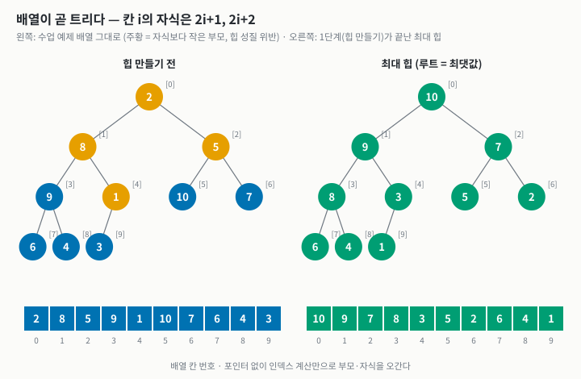

**확인한 것.** 수업 예제 배열 `2 8 5 9 1 10 7 6 4 3`을 트리로 그리면(왼쪽) 힙 성질이
깨진 부모가 넷(주황)이다. 우리 `heapSort`의 1단계가 끝난 배열은 `10 9 7 8 3 5 2 6 4 1`이고
(오른쪽), 모든 부모가 자식보다 크다.

#### Q3. 어떻게 정렬하나?

**배운 것.** 두 단계다.

```text
HeapSort(A, n)
    // 1단계: 힙 만들기 (heapify) — 아래 층 부모부터 거꾸로
    for i <- n/2 - 1 downto 0
        SiftDown(A, i, n)
    // 2단계: 하나씩 꺼내기
    for end <- n-1 downto 1
        swap(A[0], A[end])      // 최댓값을 맨 뒤로 — 자리 확정
        SiftDown(A, 0, end)     // 줄어든 힙을 다시 고친다

SiftDown(A, i, n)               // A[i]를 제자리까지 끌어내린다
    while i에 자식이 있다
        c <- 두 자식 중 큰 쪽            // 비교 1
        if A[c] <= A[i] then break     // 비교 2
        swap(A[i], A[c]); i <- c
```

**확인한 것 — 수업 예제 배열 한 걸음씩.** (`|` 뒤가 자리가 확정된 부분)

| 단계 | 배열 |
| --- | --- |
| 시작 | `2 8 5 9 1 10 7 6 4 3` |
| 1단계 i=4 | `2 8 5 9 3 10 7 6 4 1` — 1과 자식 3을 바꿈 |
| 1단계 i=3 | `2 8 5 9 3 10 7 6 4 1` — 9는 자식 6, 4보다 커서 그대로 |
| 1단계 i=2 | `2 8 10 9 3 5 7 6 4 1` — 5가 한 층 내려감 |
| 1단계 i=1 | `2 9 10 8 3 5 7 6 4 1` — 8이 한 층 내려감 |
| 1단계 i=0 | `10 9 7 8 3 5 2 6 4 1` — 2가 두 층 내려감. **힙 완성, 비교 13회** |
| 2단계 end=9 | `9 8 7 6 3 5 2 1 4` \| `10` |
| 2단계 end=8 | `8 6 7 4 3 5 2 1` \| `9 10` |
| 2단계 end=7 | `7 6 5 4 3 1 2` \| `8 9 10` |
| … | … |
| 2단계 end=1 | `1` \| `2 3 4 5 6 7 8 9 10` — **총 비교 40회** |

#### Q4. 힙 만들기가 왜 `O(n log n)`이 아니라 `O(n)`인가?

**배운 것.** `SiftDown` 한 번은 최대 트리 높이 `log n`만큼 내려가니 `n/2`번이면
`O(n log n)`처럼 보인다. 그런데 **대부분의 노드는 바닥 근처에 있어서 거의 안 내려간다.**
높이 `h`인 노드는 약 `n/2^(h+1)`개이고 각각 최대 `h`번 내려가므로

```text
Σ  n/2^(h+1) · h  =  n · Σ h/2^(h+1)  =  n · 1  =  O(n)
```

절반(잎)은 0번, 4분의 1은 1번, 8분의 1은 2번 … 이 합이 `n`을 넘지 않는다.

**확인한 것.** 위 추적에서 원소 10개로 힙을 만드는 데 비교가 **13회**였다.
`2n = 20`을 넘지 않는다. 반면 2단계(꺼내기)는 나머지 **27회**를 썼다. 힙 정렬의 비용은
거의 전부 2단계에 있다.

#### Q5. 왜 불안정한가?

**배운 것.** 2단계의 `swap(A[0], A[end])`가 루트를 **배열 맨 끝으로 멀리** 보낸다. 같은 값이
둘 있으면 어느 쪽이 먼저 루트에 올라오는지는 트리 모양이 정하고, 입력 순서와 상관없다.

**확인한 것.** `(3,a) (1,b) (3,c) (2,d) (1,e)` → 힙 정렬 결과 `(1,b) (1,e) (2,d) (3,c) (3,a)`.
`3`끼리 순서가 뒤집혔다. 유닛 테스트(`안정성 (표의 stable 값과 일치)`)와 n = 100,000
실험(3.5)에서도 불안정으로 측정됐다.

#### Q6. 구현할 때 AI가 알려 준 요령과, 내가 고른 것

1. **교환 대신 "구멍" 내리기.** `SiftDown`에서 매번 `swap`(이동 3회)하지 않고, 내려갈 원소를
   `tmp`에 들어 둔 채 큰 자식을 한 칸씩 **끌어올리고**, 멈춘 자리에 `tmp`를 놓는다(이동 1회).
   삽입 정렬이 교환 대신 밀어내는 것과 같은 요령이다. → **채택.** 그 결과 힙 정렬이 셋 중
   **이동 횟수가 가장 적다**(3.3).
2. **재귀 대신 반복문.** `SiftDown`은 꼬리 재귀라 반복문으로 바로 풀린다. → **채택.**
   재귀 깊이 1, 스택도 `O(1)`. 셋 중 유일하게 **스택까지 포함해 진짜 `O(1)` 메모리**다.
3. **bottom-up heapsort** (Wegener) — 비교를 한 층에 1회로 줄이는 변형. → 이번엔
   **채택하지 않음.** 수업 수준에서 "표준 힙 정렬"을 재는 것이 비교의 목적이라서다.
   한계(5장)에 적어 두었다.

#### Q7. 실전에서는 어디 쓰이나?

**배운 것.** C++ `std::sort`의 **introsort**가 대표적이다. 퀵 정렬로 시작하다가 재귀가
`2·log n`보다 깊어지면(= 피벗이 계속 나쁘면) **힙 정렬로 갈아탄다.** 퀵의 평균 속도와
힙의 최악 보장을 합친 것이다. 리눅스 커널의 `lib/sort.c`도 힙 정렬이다 —
커널에서는 추가 메모리 할당과 깊은 재귀를 모두 피해야 하기 때문이다.

**확인한 것.** 이 설명은 3.6의 피벗 실험과 맞아떨어진다. 퀵 정렬이 무너질 때 재귀가
**9,999단**(정렬된 입력, 첫 원소 피벗)이나 **12,583단**(중복 많음)까지 깊어지는 것을 실측했고,
introsort는 바로 그 "깊어짐"을 신호로 힙 정렬로 넘어간다.

<div style="page-break-before: always"></div>

## 3. 알고리즘 실험

### 3.1 무엇을 어떻게 쟀나

| 재는 것 | 방법 | 주의 |
| --- | --- | --- |
| 시간 | `clock()`, 입력 복사를 뺀 정렬 구간만, 여러 번 돌려 평균 | 기계에 흔들린다. 같은 표 안에서만 견준다 |
| 비교 · 이동 | 구현이 `SortStats`에 센다. 교환 1회 = 이동 3회 | **재현된다.** 보고서는 이쪽을 앞세운다 |
| 힙 메모리 | `extraBytes` — 입력 배열 밖에 잡은 최대 바이트 | 병합의 `temp`가 여기 잡힌다 |
| 스택 메모리 | `maxDepth` — 실제로 들어간 최대 재귀 깊이 | 퀵의 `O(log n)`이 여기 잡힌다 |
| 안정성 | `tag` 순서 실측 | 같은 `key`가 있어야 판정이 뜻을 가진다(3.5) |

입력 모양은 넷이다: **무작위**(`rand()`), **정렬됨**, **역순**, **중복많음**(`rand() % 8`,
서로 다른 key가 8개뿐). 씨앗을 고정해 매번 같은 입력을 쓴다. 아래 표와 그래프는
**한 번의 같은 실행**에서 나왔고 원본은 `report/results.csv`, `report/pivot.csv`에 있다.

### 3.2 한 줄 비교 — 수업 예제 배열

수업 슬라이드의 그 배열(`2 8 5 9 1 10 7 6 4 3`, n = 10)에서 셋을 재면:

| | 비교 | 이동 | 추가 메모리 | 재귀 깊이 | 안정성 |
| --- | --- | --- | --- | --- | --- |
| 병합 정렬 | **22** | 68 | temp 10칸 + 1칸 | 4 | 안정 |
| 퀵 정렬 (첫 원소 피벗 = 수업 코드) | 25 | **21** | 1칸 | 5 | 불안정 |
| 퀵 정렬 (랜덤 피벗 = 이 과제) | 19 | 51 | 1칸 | 3 | 불안정 |
| 힙 정렬 | 40 | 69 | 1칸 | **1** | 불안정 |

병합 · 퀵(첫 원소)의 숫자는 주제 04 슬라이드 "병합과 나란히" 표와 같다(22·68 / 25·21).
여기에 힙 정렬을 한 줄 더 놓으면 **힙은 비교를 두 배 가까이 쓰는 대신 추가 메모리와 재귀가
모두 없다**는 것이 이미 보인다. 이하 실험은 이 인상이 큰 n에서도 맞는지 확인하는 과정이다.

### 3.3 입력 모양별 (n = 100,000, 3회 평균)

| 입력 | 알고리즘 | 시간(ms) | 비교 | 이동 | 추가 메모리 | 재귀 깊이 | 안정성 |
| --- | --- | --- | --- | --- | --- | --- | --- |
| 무작위 | mergeSort | 35.7 | **1,536,567** | 3,337,856 | 800,008 B | 17 | 안정 |
| 무작위 | quickSort | **27.3** | 2,007,559 | 2,981,454 | 8 B | 38 | 불안정 |
| 무작위 | heapSort | 35.0 | 3,020,161 | **2,054,298** | 8 B | 1 | 불안정 |
| 정렬됨 | mergeSort | 21.4 | 853,904 | 3,337,856 | 800,008 B | 17 | (판정 불가) |
| 정렬됨 | quickSort | **8.1** | 2,036,840 | **301,056** | 8 B | 38 | (판정 불가) |
| 정렬됨 | heapSort | 28.6 | 3,112,517 | 2,150,848 | 8 B | 1 | (판정 불가) |
| 역순 | mergeSort | 22.3 | **815,024** | 3,337,856 | 800,008 B | 17 | (판정 불가) |
| 역순 | quickSort | **17.3** | 1,984,542 | 2,395,284 | 8 B | 40 | (판정 불가) |
| 역순 | heapSort | 27.6 | 2,926,640 | 1,897,428 | 8 B | 1 | (판정 불가) |
| 중복많음 | mergeSort | 26.5 | 1,468,243 | 3,337,856 | 800,008 B | 17 | 안정 |
| 중복많음 | quickSort | **1,454.9** | **625,400,585** | 974,763 | 8 B | **12,583** | 불안정 |
| 중복많음 | heapSort | **25.7** | 2,693,152 | 1,822,412 | 8 B | 1 | 불안정 |

("판정 불가"는 key가 모두 달라서 안정성을 볼 수 없다는 뜻이다. 3.5에서 설명한다.)

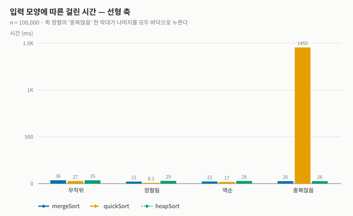

선형 축에서는 **막대 하나만 보인다.** 퀵 정렬의 "중복많음"(1,455 ms)이 나머지를 모두
바닥으로 누른다. 이것이 이 실험에서 가장 큰 발견이다(→ 3.3.1).

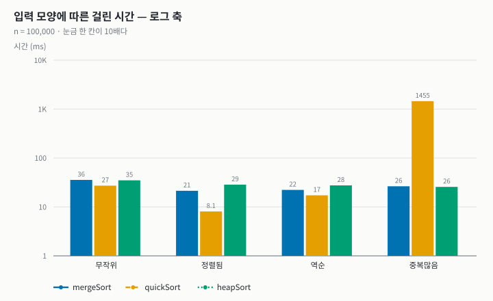

로그 축으로 펴면 나머지가 읽힌다.

- **퀵 정렬이 네 입력 중 셋에서 가장 빠르다.** 특히 정렬됨(8.1 ms)에서 압도적이다.
  랜덤 피벗이면 이미 정렬된 배열은 파티션마다 "작은 것"이 제자리에 있어 `i == j`라 교환을
  건너뛴다. 이동이 **301,056회**로 병합의 11분의 1이다.
- **힙 정렬은 입력을 거의 타지 않는다** (25.7~35.0 ms). 병합(21.4~35.7 ms)도 비슷하다.
  둘 다 최악이 `n log n`이라는 이론과 맞는다.
- **병합 정렬은 정렬됨 · 역순에서 빨라진다** — 비교가 절반 가까이(85만, 82만) 줄기 때문이다.

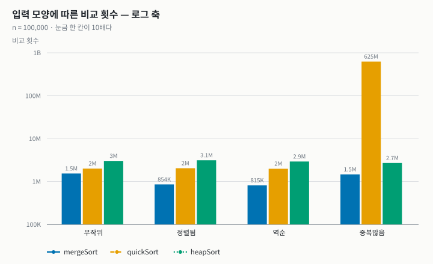

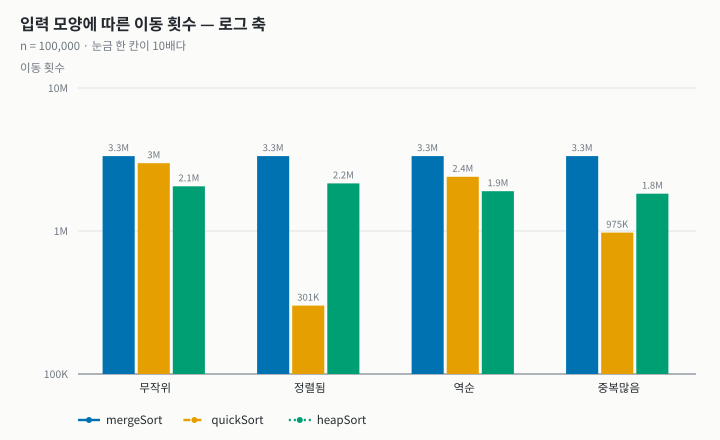

- **비교는 병합 < 퀵 < 힙, 이동은 힙 < 퀵 < 병합.** 정확히 반대 순서다.
  - 병합은 비교가 가장 적다. 정렬된 두 묶음의 **맨 앞끼리만** 보면 되기 때문이다.
    대신 원소마다 `temp`에 갔다 오느라 이동이 가장 많다.
  - 힙은 한 층 내려갈 때마다 비교가 2번(두 자식 중 큰 쪽, 그리고 그것과 내려가는 원소)이라
    비교가 가장 많다. 대신 "구멍 내리기"(2.3 Q6) 덕분에 이동이 가장 적다.
- **병합의 이동은 네 입력에서 모두 3,337,856회로 똑같다.** 2.1에서 말한 대로 병합은
  입력과 상관없이 원소를 정해진 만큼 옮긴다.

#### 3.3.1 퀵 정렬이 중복 앞에서 무너진 이유

비교 **625,400,585회**, 재귀 **12,583단**. 평소(200만)의 300배다. 피벗을 랜덤으로
골라도 피하지 못했다(3.6에서 세 피벗 방식 모두 같은 결과). 원인은 피벗이 아니라
**파티션의 조건**이다.

수업의 파티션은 `a[j] < pivot`인 것만 왼쪽으로 보낸다. 피벗과 **같은** 값은 전부 오른쪽에
남는다. 서로 다른 key가 8개뿐인 배열은 결국 "모두 같은 값"인 구간 8개로 쪼개지는데,
모두 같은 값인 구간 `k`개를 파티션하면

- 비교 `k-1`회를 해도 왼쪽으로 가는 것이 하나도 없다 → 피벗이 맨 앞에 그대로 남는다
- 다음 재귀는 `k-1`개짜리 → 이것이 `k`번 반복된다: 비교 `k(k-1)/2`, 재귀 `k`단

n = 100,000을 8개 값으로 나누면 한 값이 약 12,500개이므로

```text
8 × 12,500 × 12,499 / 2  ≈  624,950,000회   (실측 625,400,585회)
최대 재귀 깊이 ≈ 가장 큰 묶음 크기           (실측 12,583단)
```

**계산과 실측이 맞는다.** 정렬된 입력의 `O(n²)`(수업에서 본 함정)은 랜덤 피벗이 없애지만,
**같은 값이 많은 입력의 `O(n²)`은 피벗이 아니라 파티션을 고쳐야** 없어진다.
해결책은 **3-way 파티션**(Dijkstra의 네덜란드 국기 문제: `< pivot | = pivot | > pivot`)이나,
같은 값에서 양쪽 포인터가 모두 멈추는 **Hoare 파티션**이다. 병합과 힙은 이 입력에서
오히려 조금 빨라졌다. 퀵 정렬 하나만 입력의 "모양"이 아니라 "**값의 분포**"에 약하다는 것이
이 실험에서 새로 알게 된 점이다.

### 3.4 n을 키우며 (무작위, n = 1,000 ~ 1,000,000)

| n | merge 비교 | quick 비교 | heap 비교 | merge (ms) | quick (ms) | heap (ms) |
| --- | --- | --- | --- | --- | --- | --- |
| 1,000 | 8,715 | 12,061 | 16,808 | 0.200 | **0.138** | 0.204 |
| 3,000 | 30,919 | 38,020 | 60,298 | 0.705 | **0.546** | 0.720 |
| 10,000 | 120,434 | 157,334 | 235,417 | 2.748 | **2.180** | 2.723 |
| 30,000 | 408,633 | 530,209 | 800,651 | 9.354 | **7.648** | 9.303 |
| 100,000 | 1,536,567 | 2,007,559 | 3,020,161 | 34.39 | **26.95** | 35.05 |
| 300,000 | 5,084,839 | 6,692,813 | 10,001,142 | 114.1 | **90.4** | 118.0 |
| 1,000,000 | 18,674,313 | 25,285,253 | 36,794,207 | 413.6 | **328.2** | 449.6 |

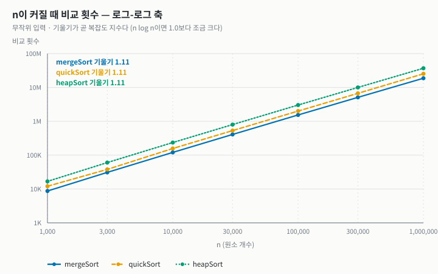

로그-로그 축에서 기울기가 곧 복잡도 지수다. 셋 다 **1.11**이다. 같은 구간에서
`n log n` 자체의 기울기가 **1.10**이므로 셋 다 `n log n`으로 자란다. 샘플 과제에서
`O(n²)` 정렬들이 기울기 2.0을 보였던 것과 대조된다. **복잡도로는 셋을 가를 수 없다.**

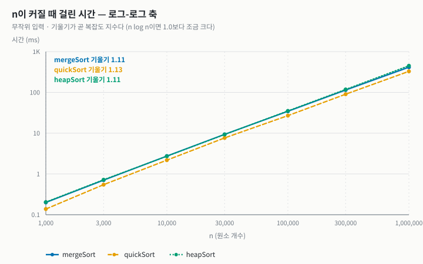

시간도 기울기 1.10~1.13으로 같다. 그렇다면 셋을 가르는 것은 무엇인가 — **상수**다.

#### 3.4.1 상수 계수: 비교 ÷ `n log₂n`

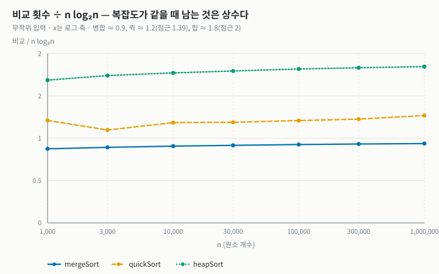

비교 횟수를 `n log₂n`으로 나누면 복잡도가 지워지고 **상수만 남는다.**

| | n = 1,000 | n = 1,000,000 | 이론적 점근값 | 왜 |
| --- | --- | --- | --- | --- |
| 병합 | 0.87 | **0.94** | 1 | 병합 한 번에 비교 ≤ 원소 수. 한쪽이 먼저 바닥나면 더 적다 |
| 퀵 (랜덤) | 1.21 | **1.27** | `2 ln 2 ≈ 1.39` | 피벗이 정확히 한가운데가 아니라서 평균적으로 39% 더 든다 |
| 힙 | 1.69 | **1.85** | 2 | 한 층에 비교 2회 × 높이 `log n` |

세 값 모두 n이 커질수록 이론값을 향해 올라간다. **힙 정렬은 병합 정렬의 약 2배를
비교한다.** 비교 함수가 비싼 경우(문자열, 구조체 여러 필드)라면 이 2배가 그대로 시간이 된다.

#### 3.4.2 캐시: 시간 ÷ `n log₂n`

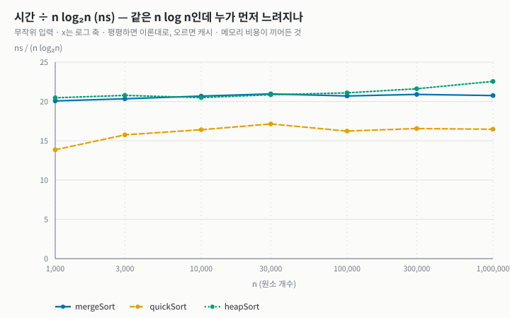

비교를 두 배 하는데도 힙 정렬은 n = 30,000까지 병합 정렬과 시간이 **같다**(n = 10,000에서 20.5 vs 20.7 ns).
비교는 많지만 이동이 가장 적기 때문이다. 그런데 n이 커지면 이야기가 달라진다.

| ns / (n log₂n) | n = 10,000 | n = 1,000,000 | 변화 |
| --- | --- | --- | --- |
| 병합 | 20.68 | 20.75 | **+0.3%** (평평) |
| 퀵 | 16.41 | 16.46 | **+0.3%** (평평) |
| 힙 | 20.49 | 22.56 | **+10.1%** (오른다) |

**힙 정렬만 n이 커질수록 원소당 비용이 오른다.** 병합과 퀵은 배열을 **앞에서 뒤로 차례로**
훑는다(병합의 두 포인터, 파티션의 `j`). CPU 캐시가 가장 좋아하는 모양이다. 힙 정렬은
칸 `i`에서 `2i+1`로 **점프**한다. 트리의 아래 층일수록 부모와 자식이 배열에서 멀리 떨어져,
n이 커져 배열이 캐시를 넘어서면(n = 300,000이면 2.4 MB, 10⁶이면 8 MB — 이 기계의 L2는 4 MiB) 아래 층으로 내려갈 때마다 캐시를 놓친다.
Big-O가 같아도 **메모리 접근 패턴**이 시간을 가른다는 것을 실측으로 확인했다.
n = 1,000,000에서 힙은 병합보다 **9%**, 퀵보다 **37%** 느리다.

### 3.5 메모리 · 재귀 깊이 · 안정성

| 알고리즘 | 추가 메모리 (n = 10⁶) | 재귀 깊이 (n = 10⁶, 무작위) | 최악 재귀 깊이 (실측) | 안정성 |
| --- | --- | --- | --- | --- |
| mergeSort | **8,000,008 B** | 20 (`= ⌈log₂n⌉`) | 20 — 입력 무관 | **안정** |
| quickSort | 8 B | 50 | **12,583** (n = 10⁵, 중복많음) | 불안정 |
| heapSort | 8 B | **1** | **1** — 반복문뿐 | 불안정 |

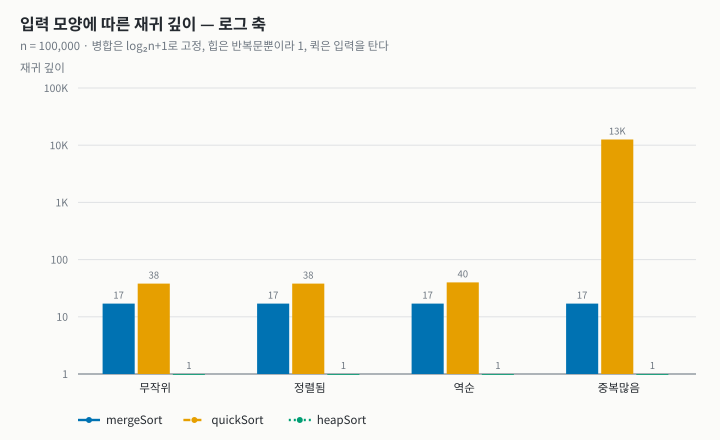

- **병합 정렬은 원소 수만큼 메모리를 더 쓴다.** n = 10⁶이면 8 MB. 이것이 병합이 안정성과
  적은 비교를 얻고 치른 값이다. 깊이는 늘 `⌈log₂n⌉`로 고정이다(위치로 반씩 자르므로).
- **퀵 정렬의 `O(log n)` 메모리는 "평균"이다.** 무작위에서 38~50단이지만 중복많음에서
  12,583단까지 갔다. 스택 프레임이 수십 바이트라 이 실험에서는 버텼지만, n이 10배면
  스택 오버플로의 위험이 있다. (더 짧은 쪽으로 먼저 재귀하고 긴 쪽은 반복문으로 돌리면
  최악에도 `O(log n)`으로 묶인다.)
- **힙 정렬만 메모리가 진짜 `O(1)`이다.** 힙 메모리도 8 B, 스택도 재귀 깊이 1이다.
  **어떤 입력에서도** 그렇다. 세 정렬 중 "최악에도 `n log n`"과 "최악에도 `O(1)` 메모리"를
  **동시에** 보장하는 것은 힙 정렬뿐이다.

**안정성 측정에서 배운 것.** 표를 보면 불안정한 퀵 · 힙이 "안정"으로 나온 칸이 있다
(`results.csv`의 정렬됨 · 역순, 그리고 무작위 n ≤ 30,000). 틀린 것이 아니라 **판정할 거리가
없었던** 것이다. 이 입력들은 key가 모두 달라서 뒤집힐 "같은 key 쌍"이 없다. 무작위 입력은
`rand()`가 0 ~ 2³¹ 범위라 n이 작으면 중복이 거의 없고, n = 100,000부터 생일 문제처럼
중복 쌍이 몇 개 생기면서 비로소 "불안정"으로 잡힌다(기대 중복 쌍 ≈ `n²/(2·2³¹)` ≈ 2.3개).
**안정성은 중복이 있는 입력에서만 잴 수 있다.** 그래서 "중복많음"과 유닛 테스트
(key 0~4만 쓰는 60개)가 안정성의 진짜 증거다.

### 3.6 추가 실험: 퀵 정렬의 피벗 (n = 10,000)

주제 04의 "피벗을 어떻게 고르나"를 직접 재 봤다. 퀵 정렬만, 피벗 고르는 법만 바꾼다.

| 입력 | 첫 원소 (수업 코드) | 셋 중 가운데 | 랜덤 (이 과제) |
| --- | --- | --- | --- |
| 무작위 | 161,185회 · 31단 · 2.1 ms | 158,323회 · 27단 · 2.2 ms | 157,334회 · 29단 · 2.1 ms |
| 정렬됨 | **49,995,000회** · **9,999단** · 112 ms | 125,439회 · 13단 · 0.5 ms | 155,798회 · 29단 · 0.7 ms |
| 역순 | **49,995,000회** · **9,999단** · 120 ms | **12,517,505회** · **2,501단** · 29 ms | 159,885회 · 33단 · 1.3 ms |
| 중복많음 | 6,276,926회 · 1,289단 · 14 ms | 6,300,753회 · 1,288단 · 15 ms | 6,278,240회 · 1,288단 · 15 ms |

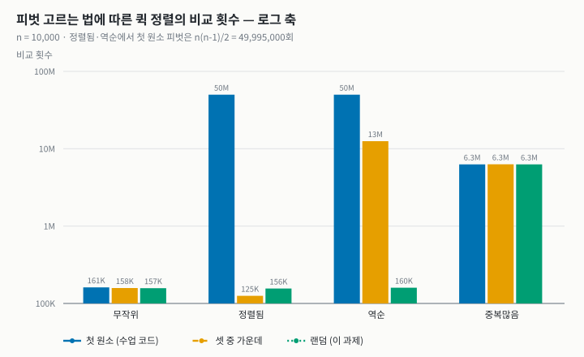

- **정렬됨 · 첫 원소 피벗 = 49,995,000회 = `n(n-1)/2`.** 수업에서 n = 10으로 본 45회가
  n = 10,000에서 정확히 같은 공식으로 나온다. 재귀는 `n-1`단 — 트리가 외길이 된다.
- **랜덤 피벗은 네 입력 중 셋에서 무작위와 같은 수준**(15~16만)을 지킨다. "최악이 특정
  입력에서 입력과 난수의 조합으로 바뀐다"는 수업의 말이 숫자로 확인된다.
- **셋 중 가운데는 역순에서 무너졌다** (1,250만회 ≈ `n²/8`, 2,501단 ≈ `n/4`). 예상 밖의
  결과라 n = 24인 역순 배열로 한 단계씩 추적해 봤다. 첫 파티션은 12 : 11로 잘 갈린다.
  그런데 그 뒤 왼쪽 구간이 `2 12 11 10 … 4 3 1`처럼 **가운데는 여전히 내림차순이고, 가장 작은
  두 값이 양 끝에 놓인** 모양이 된다. 그러면 "앞 · 가운데 · 뒤" 셋 중 가운데 값은 구간에서
  **두 번째로 작은 값**이 되고, 파티션은 1 : 10, 다음은 8 : 1, 다음은 1 : 6 … 으로 매번 한두
  개만 떼어 낸다. 셋 중 가운데는 **정해진 규칙**이라 그 규칙을 속이는 배열이 존재하고,
  역순 + Lomuto 파티션이 스스로 그런 배열을 만들어 낸 것이다. 랜덤은 규칙이 없어서 속일 수 없다.
  **이 과제에서 랜덤 피벗을 기본값으로 고른 근거가 이 표다.**
- **중복많음은 셋 다 같다.** 3.3.1에서 본 대로 문제가 피벗이 아니라 파티션이라서다.

---

## 4. 결론 — 언제 무엇을 쓰나

세 정렬은 복잡도로는 구별되지 않았다(셋 다 기울기 1.11). 갈린 것은 **각자 무엇을
내주었는가**다.

| | 내준 것 | 얻은 것 | 이럴 때 쓴다 |
| --- | --- | --- | --- |
| **병합** | 메모리 `n`칸 (n = 10⁶이면 8 MB) | 안정성, 가장 적은 비교(0.94·n log n), 입력 무관한 `n log n` | 안정성이 필요할 때(여러 기준 정렬), 비교가 비쌀 때, 연결 리스트 · 외부 정렬 |
| **퀵** | 최악 `n²`, 안정성 | 가장 빠른 평균(힙보다 37% 빠름), 추가 메모리 거의 없음 | 입력 분포를 알고 평균 속도가 중요할 때. 단 **중복이 많으면 3-way 파티션**을 써야 한다 |
| **힙** | 비교 2배, 캐시 친화성, 안정성 | **최악에도 `n log n` + 최악에도 `O(1)` 메모리** | 메모리가 빠듯하고 최악을 보장해야 할 때(임베디드, 커널), introsort의 안전망, 상위 k개만 필요할 때 |

**배우지 않은 정렬(힙)을 공부하며 얻은 것.** 수업의 두 정렬은 모두 **분할 정복**으로
`O(n²)`의 벽을 넘었다. 힙 정렬은 전혀 다른 길로 같은 벽을 넘는다 — 주제 02의 선택 정렬을
그대로 두고 **"최댓값 찾기"만 자료구조로 바꿨다.** 알고리즘을 빠르게 하는 방법이
"문제를 나누는 것"만이 아니라 "**반복되는 질문에 빨리 답하는 구조를 미리 만들어 두는 것**"이기도
하다는 것을 배웠다. 그리고 그 구조(배열 속 트리)가 메모리 접근을 흩뜨려 큰 n에서 10%의
값을 치른다는 것까지 측정으로 확인했다.

---

## 5. 한계

- **힙 정렬은 표준형이다.** bottom-up heapsort(Wegener)나 Floyd의 개선을 쓰면 비교를
  `n log n`에 가깝게 줄일 수 있다. 3.4.1의 "비교 2배"는 표준형 기준이다.
- **퀵 정렬의 파티션은 수업의 Lomuto 방식 그대로다.** 3-way 파티션을 넣으면 3.3.1의 붕괴가
  사라질 것으로 예상하지만 이번에는 재지 않았다. 원인을 계산으로 확인하는 데까지만 했다.
- **"셋 중 가운데"가 역순에서 무너지는 원인**은 n = 24로 추적해 설명했지만, 일반적인 조건을
  증명하지는 않았다.
- **시간은 기계 하나(2코어 가상 머신)에서 잰 값이다.** 3.4.2의 캐시 효과는 캐시 크기에 따라
  나타나는 n이 달라진다. 비교 · 이동 횟수를 함께 싣는 이유다.
- **스택 사용량은 바이트가 아니라 재귀 깊이로만 쟀다.** 프레임 크기는 컴파일러가 정한다.
- 병렬화(주제 03 · 04의 "동시에 할 수 있다")는 다루지 않았다. 힙 정렬은 2단계가 본질적으로
  순차적이라 병렬화가 어렵다는 점에서 병합 · 퀵과 또 한 번 갈릴 것이다.

---

## 6. 부록 — AI 사용 내역

| 사용한 곳 | 도구 | 한 일 | 내가 확인한 방법 |
| --- | --- | --- | --- |
| 힙 정렬 학습 (2.3) | Claude | 개념, 역사, `O(n)` 힙 만들기 증명, 불안정한 이유, 구현 요령, 실전 사용처 설명 | 추적 표를 직접 돌려 만들고, 비교 횟수(13 / 40회)와 불안정 예시를 코드 실행으로 확인 |
| 구현 · 테스트 · 실험 코드 | Claude | 수업 코드와 샘플 뼈대를 바탕으로 세 정렬과 측정 · 그래프 코드 작성 | 유닛 테스트 50개(수업 슬라이드의 숫자 22 · 68 · 25 · 45 재현 포함), ASan · UBSan |
| 결과 해석 | Claude | 중복많음에서 퀵 정렬 붕괴 원인, 캐시 효과 해석 | `k(k-1)/2` 계산값과 실측 비교, 정규화 그래프로 추세 확인 |

재현 방법:

```sh
make test      # 50 checks, 0 failures
make run       # 비교 표
make charts    # report/*.svg 와 results.csv · pivot.csv 를 다시 만든다 (시간은 조금씩 달라진다)
```
